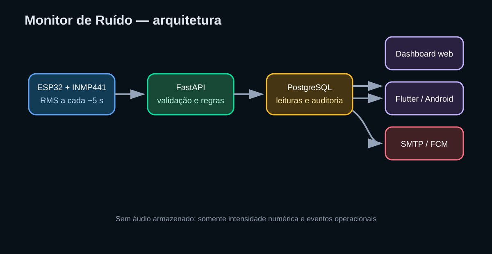
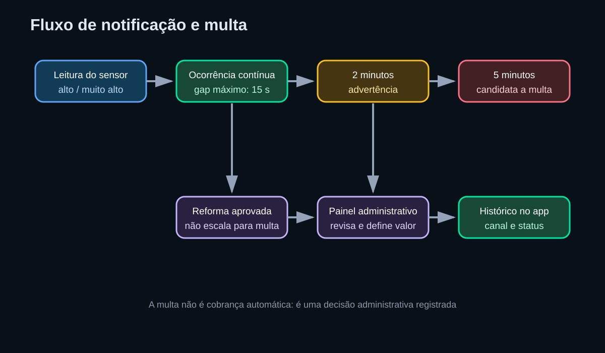

# Monitor de Ruído — apresentação do projeto

> **Apresentação executiva ao vivo:** depois de iniciar o sistema, acesse
> `http://localhost:5000/apresentacao`. Esta visão foi criada para
> demonstrações, reuniões e apresentação do produto; o painel operacional
> continua em `/` e a administração em `/admin`.

1. Objetivo

Monitorar a intensidade sonora de quatro áreas usando ESP32 e INMP441,
registrar as leituras e avisar moradores e administradores quando houver
ruído alto durante o horário de silêncio.

O sistema trabalha com RMS/classificação de intensidade. Ele não grava,
transmite ou armazena áudio.

## 2. Arquitetura



```text
INMP441 -> ESP32 -> Wi-Fi -> FastAPI -> PostgreSQL
                                  |-> Dashboard web
                                  |-> Aplicativo Flutter/Android
                                  |-> E-mail SMTP / Push FCM
```

## 3. Fluxo operacional



1. O sensor envia uma leitura aproximadamente a cada cinco segundos.
2. O backend valida e salva a leitura.
3. Durante o silêncio, leituras `alto` ou `muito_alto` iniciam uma ocorrência.
4. Após dois minutos contínuos, o sistema registra uma advertência.
5. Após cinco minutos contínuos, registra uma candidata a multa.
6. O administrador revisa reformas e multas no painel.
7. O morador acompanha as notificações no aplicativo.

## 4. Funcionalidades entregues

- Cadastro de sensores e moradores.
- Login, convites, sessões e papéis de acesso.
- Associação de moradores às casas/sensores.
- Dashboard web e aplicativo Flutter.
- Histórico de notificações no aplicativo.
- Alertas por push e e-mail, com modo simulado sem credenciais.
- Ocorrências contínuas com escalonamento em 2 e 5 minutos.
- Solicitação e aprovação de reformas.
- Revisão administrativa de multas.
- Auditoria, migrations e testes automatizados.

## 5. Segurança e privacidade

- Senhas protegidas com hash.
- Tokens de convite armazenados de forma protegida.
- Controle de acesso por morador/admin.
- Deduplicação das leituras por sensor e sequência.
- O áudio não é armazenado.
- SMTP, FCM e HTTPS devem ser configurados antes de exposição pública.

## 6. Demonstração

### Servidor

```powershell
curl.exe http://localhost:5000/health
curl.exe "http://localhost:5000/api/readings?limit=10"
```

### Android Studio

Abra `app/`, execute `flutter pub get`, conecte um dispositivo e rode:

```powershell
flutter devices
flutter run
```

No celular físico use `http://IP_DO_COMPUTADOR:5000`. No emulador Android use
`http://10.0.2.2:5000`.

## 7. Estado atual

O código está publicado na branch `feature/autenticacao-notificacoes` e no
PR #2. A versão atual já foi implantada no Docker local preservando o banco.
As credenciais reais de FCM/SMTP, HTTPS, cobrança financeira e a validação
física do AP4 continuam dependentes do ambiente.

